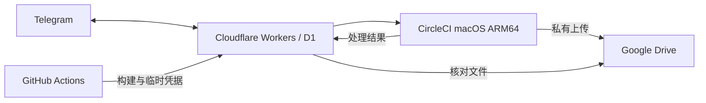

# 架构说明

服务采用轻量控制面和按需工作机分工。任务状态长期保留，处理工作机在任务到来时启动。

## 组件职责

| 组件 | 职责 |
| --- | --- |
| Telegram | 接收应用请求，显示任务列表，提供取消和领取按钮 |
| Cloudflare Workers | 校验请求、准入和串行派发，核对结果并发送通知 |
| D1 | 保存任务、去重意图、会话交接记录、目录及通知状态 |
| CircleCI | 加载已验证运行包，恢复任务凭据，执行下载、模型复用、校验和私有上传 |
| GitHub Actions | 构建与测试，按角色签发短期凭据信封，执行受控维护切换 |
| Google Drive | 保存私有文件；控制面检查归属、权限、名称、大小和摘要 |

## 请求流程

1. 控制面解析真实私聊输入，生成固定请求号并保存派发意图。
2. 空闲容量允许时，提交绑定源码和任务身份的 CircleCI 运行。
3. 工作机取得短期角色凭据，验证公共运行包的来源、摘要及主机兼容性。
4. 原生工具处理应用，执行页面、归档和账号数据清理检查。
5. 文件上传后，控制面独立核验私有文件，再记录完成并通知接收人。

定时触发负责核对外部运行和推进队列。提交、接受邀请或通知结果不明时保留原意图，避免重复操作。

## 状态与凭据

Apple 账号和模型由 GitHub 管理，工作机只接收本任务所需的短期角色信封。目录查询不加载导出模型。交付主私钥和 Drive 刷新凭据不交给 CircleCI 工作机。

生产分支与控制面源码必须一致。发布顺序及配置约束见[维护手册](OPERATIONS.md)，固定公共运行包见[来源清单](../deploy/managed/circleci/runtime-pins.json)。

历史架构探索与迁移方案见[归档](archive/2026-11-27/MANAGED-RUNTIME.md)。
